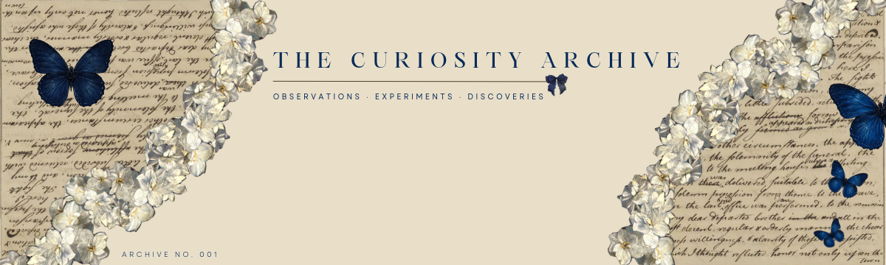
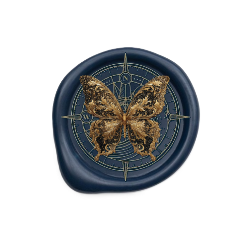

  

    

✦ &nbsp;˖&nbsp; ✧ &nbsp;˖&nbsp; ･ &nbsp;🦋&nbsp; ･ &nbsp;˖&nbsp; ✧ &nbsp;˖&nbsp; ✦

<table align="center">
<tr><td align="center" width="170"></td>
<td>
<h2>Niama ES-SELYMY</h2>
<i>Intelligent Systems Engineering · Cloud, Networks &amp; Security</i>  
 
 
 

</td></tr>
</table>

Greetings, fellow explorer. I explore where <b>AI, cybersecurity and cloud infrastructure</b> meet: how intelligent systems work, how to secure them, and how technology can solve problems beyond the screen. I move between experimentation and engineering, then turn the ideas into things that actually run.

<i>“Every system has something to teach. Every experiment leaves a trace.”</i>

✦ &nbsp;˖&nbsp; ✧ &nbsp;˖&nbsp; ･ &nbsp;🦋&nbsp; ･ &nbsp;˖&nbsp; ✧ &nbsp;˖&nbsp; ✦

  

     

✦ &nbsp;˖&nbsp; ✧ &nbsp;˖&nbsp; ･ &nbsp;🦋&nbsp; ･ &nbsp;˖&nbsp; ✧ &nbsp;˖&nbsp; ✦

<table>
<tr>
<td width="140" align="center" valign="middle">  <h1>🌾</h1><b>FarmShield</b> IoT · AI · Agritech</td>
<td valign="top"><b>FarmShield</b> · Team of 3 · Private repository Offline-capable farm security. A three-model AI cascade (human/animal → dangerous animal → face recognition), Isolation Forest for insider-theft anomalies, automatic siren and irrigation-valve response, and push alerts targeting under 5 seconds.        </td>
<td width="140" align="center" valign="middle">  <h1>♟️</h1><b>TACTIX // BLACKBOX</b> Game AI · Algorithms</td>
<td valign="top"><b>TACTIX // BLACKBOX</b> · Team of 3 · <a href="https://github.com/noura1se/TACTIX-blackbox">Repository</a> A strategy engine for 3×3 to 5×5 boards: Minimax with Alpha-Beta pruning, transposition tables, sliding-window heuristics, fork detection, LIFO undo and an analytics dashboard.     </td>
</tr>
<tr>
<td width="140" align="center" valign="middle">  <h1>🩺</h1><b>Coravita Clinic</b> Local RAG · LLM</td>
<td valign="top"><b>Coravita Clinic</b> · Team of 3 A private, local-first RAG assistant for clinic staff. Docling parses records and policies, Qdrant stores the vectors, LLaMA 3.2 on Ollama answers, and sensitive data never leaves the clinic.      </td>
<td width="140" align="center" valign="middle">  <h1>📜</h1><b>Document Analysis</b> LLM · Distributed Systems</td>
<td valign="top"><b>Document Analysis Platform</b> · Final-year project · Team of 3 Transcripts, certificates and formal requests are indexed in Elasticsearch, checked against configurable business rules, analysed by an LLM and processed asynchronously through Kafka.      </td>
</tr>
</table>

Also in the archive: <a href="https://github.com/Niama-ES/LumeniaAcademy"><b>Lumenia Academy</b></a> (learning platform) · <a href="https://github.com/Niama-ES/PointageVirtuel"><b>Pointage Virtuel</b></a> (attendance platform from my internship)

✦ &nbsp;˖&nbsp; ✧ &nbsp;˖&nbsp; ･ &nbsp;🦋&nbsp; ･ &nbsp;˖&nbsp; ✧ &nbsp;˖&nbsp; ✦

<table>
<tr>
<td width="190" valign="middle"></td>
<td>      </td>
</tr>
<tr>
<td width="190" valign="middle"></td>
<td>        </td>
</tr>
<tr>
<td width="190" valign="middle"></td>
<td>         </td>
</tr>
<tr>
<td width="190" valign="middle"></td>
<td>      </td>
</tr>
<tr>
<td width="190" valign="middle"></td>
<td>          </td>
</tr>
<tr>
<td width="190" valign="middle"></td>
<td>      </td>
</tr>
</table>

✦ &nbsp;˖&nbsp; ✧ &nbsp;˖&nbsp; ･ &nbsp;🦋&nbsp; ･ &nbsp;˖&nbsp; ✧ &nbsp;˖&nbsp; ✦

<table>
<tr>
<td width="140" align="center" valign="middle">  <h1>🛡️</h1><b>Agent Hijacking Defense</b> AI Security</td>
<td valign="top"><b>AI Agent Hijacking Defense</b> · Active research · Team of 3 A security layer between AI agents and the content they read: emails, documents, web pages, connected tools. It inspects content <i>before</i> the agent acts, blocking hidden instructions (prompt injection, OWASP LLM01) to prevent unintended actions and data leakage.    </td>
<td width="140" align="center" valign="middle">  <h1>🕸️</h1><b>Adaptive Zero Trust</b> eBPF · Containers</td>
<td valign="top"><b>Adaptive Zero Trust</b> · Active research · Master's project Lateral-movement detection and dynamic isolation across a multi-zone container network. eBPF programs monitor connections and enforce policy through live-updated maps; an agent graph collects, correlates, classifies, decides and verifies, while a "devil's advocate" node challenges isolation decisions to cut false positives.     </td>
</tr>
</table>

<b>Currently exploring:</b> AI agent security · eBPF &amp; Linux networking · container security · cloud infrastructure · ethical hacking

✦ &nbsp;˖&nbsp; ✧ &nbsp;˖&nbsp; ･ &nbsp;🦋&nbsp; ･ &nbsp;˖&nbsp; ✧ &nbsp;˖&nbsp; ✦

<table>
<tr>
<td valign="top" width="50%">
<b>✦ CERTIFICATIONS</b>  
◆ <b>Core Principles of Large Language Models</b> · Apr 2026 
◆ <b>Rapid Application Development with LLMs</b> · NVIDIA DLI · 2026 
◆ <b>Introduction to Agentic AI</b> · IEEE SB FSAC · Mar 2026 
◆ <b>Introduction to Cybersecurity</b> · Cisco · 2026 
◆ <b>Ethical Hacking</b> · Cisco · in progress
</td>
<td valign="top" width="50%">
<b>✦ SOCIETIES &amp; COLLABORATIONS</b>  
◆ <b>IEEE Student Branch UH2</b> · Vice-President, Communication &amp; Media · Mar 2026 – Now 
◆ <b>AIESEC Morocco · Casablanca</b> · Former Middle Manager Marketing &amp; ICX Member · Feb 2025 – Feb 2026 
◆ <b>Eurafric Maroc</b> · Software Engineering Intern · Dec 2024 – Feb 2025
</td>
</tr>
</table>

✦ &nbsp;˖&nbsp; ✧ &nbsp;˖&nbsp; ･ &nbsp;🦋&nbsp; ･ &nbsp;˖&nbsp; ✧ &nbsp;˖&nbsp; ✦

  <em>Every discovery begins with a question. Every collaboration with a conversation.</em>

  
  
  

  

  <strong>E N D &nbsp; O F &nbsp; C U R R E N T &nbsp; V O L U M E</strong>
   
  <em>The archive is never truly complete.</em>
   
  CURIOUS BY NATURE · ENGINEERING BY DESIGN

