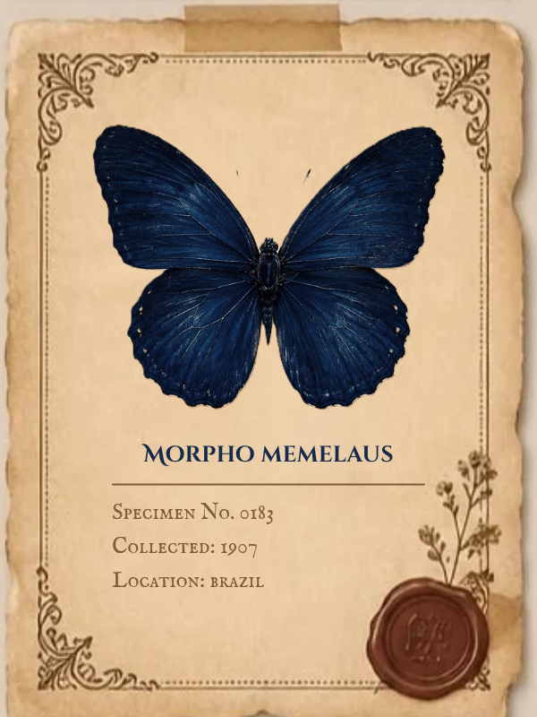
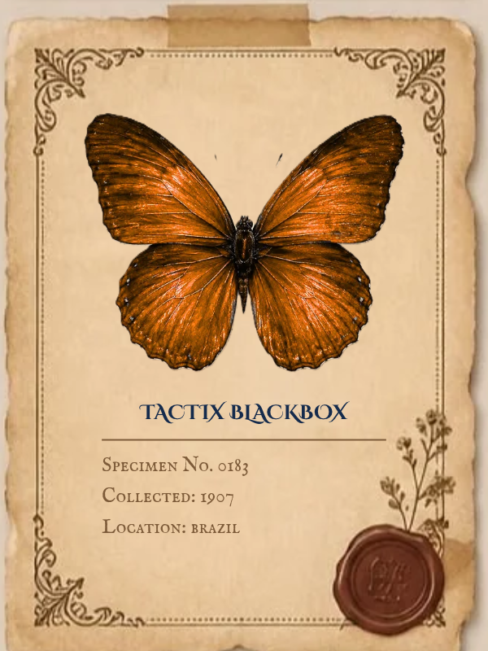

  

<b>VOL. I · 2026</b> &nbsp;✦&nbsp; <i>where curiosity becomes creation</i> &nbsp;✦&nbsp; <b>ARCHIVE Nº 001</b>

✦ &nbsp;˖&nbsp; ✧ &nbsp;˖&nbsp; ･ &nbsp;🦋&nbsp; ･ &nbsp;˖&nbsp; ✧ &nbsp;˖&nbsp; ✦

<h2 align="center">✦ &nbsp;I · THE KEEPER OF THE ARCHIVE&nbsp; ✦</h2>

<table align="center">
<tr><td align="center" width="170"></td>
<td>
<h3>Niama ES-SELYMY</h3>
<i>Intelligent Systems Engineering · Cloud, Networks &amp; Security</i>  
◆ <b>Institution</b> · Faculty of Sciences Ain Chock, Université Hassan II 
◆ <b>Coordinates</b> · Casablanca, Morocco 
◆ <b>Fields</b> · AI · Cybersecurity · Cloud &amp; Networking 
◆ <b>Society</b> · Vice-President, Communication &amp; Media, IEEE UH2
</td></tr>
</table>

Greetings, fellow explorer. I explore where <b>AI, cybersecurity and cloud infrastructure</b> meet: how intelligent systems work, how to secure them, and how technology can solve problems beyond the screen. I move between experimentation and engineering, then turn the ideas into things that actually run.

<i>“Every system has something to teach. Every experiment leaves a trace.”</i>

✦ &nbsp;˖&nbsp; ✧ &nbsp;˖&nbsp; ･ &nbsp;🦋&nbsp; ･ &nbsp;˖&nbsp; ✧ &nbsp;˖&nbsp; ✦

<h2 align="center">✦ &nbsp;II · THE DISCOVERY MAP&nbsp; ✦</h2>

  

01 · Artificial Intelligence &nbsp;✦&nbsp; 02 · Cybersecurity &nbsp;✦&nbsp; 03 · Cloud &amp; Networking &nbsp;✦&nbsp; 04 · Software Engineering

✦ &nbsp;˖&nbsp; ✧ &nbsp;˖&nbsp; ･ &nbsp;🦋&nbsp; ･ &nbsp;˖&nbsp; ✧ &nbsp;˖&nbsp; ✦

<h2 align="center">✦ &nbsp;III · THE SPECIMEN COLLECTION&nbsp; ✦</h2>

<table>
<tr>
<td width="170" align="center" valign="middle"></td>
<td valign="middle"><b>FarmShield</b> SPECIMEN 001 · IoT · AI · Agritech · Team of 3 · Private repository  Offline-capable farm security. A three-model AI cascade (human/animal → dangerous animal → face recognition), Isolation Forest for insider-theft anomalies, automatic siren and irrigation-valve response, and push alerts targeting under 5 seconds.  <code>ESP32</code> <code>MQTT</code> <code>Node.js</code> <code>PostgreSQL</code> <code>React Native</code> <code>Flask</code> <code>TFLite</code></td>
<td width="170" align="center" valign="middle"></td>
<td valign="middle"><b>TACTIX // BLACKBOX</b> SPECIMEN 002 · Game AI · Algorithms · Team of 3 · <a href="https://github.com/noura1se/TACTIX-blackbox">Repository</a>  A strategy engine for 3×3 to 5×5 boards: Minimax with Alpha-Beta pruning, transposition tables, sliding-window heuristics, fork detection, LIFO undo and an analytics dashboard.  <code>Python</code> <code>Flask</code> <code>SQLite</code> <code>Tailwind</code></td>
</tr>
<tr>
<td width="170" align="center" valign="middle"></td>
<td valign="middle"><b>Coravita Clinic</b> SPECIMEN 003 · Local RAG · LLM · Team of 3  A private, local-first RAG assistant for clinic staff. Docling parses records and policies, Qdrant stores the vectors, LLaMA 3.2 on Ollama answers, and sensitive data never leaves the clinic.  <code>Python</code> <code>Ollama</code> <code>Qdrant</code> <code>Docling</code> <code>Streamlit</code></td>
<td width="170" align="center" valign="middle"></td>
<td valign="middle"><b>Document Analysis Platform</b> SPECIMEN 004 · LLM · Distributed Systems · Final-year project · Team of 3  Transcripts, certificates and formal requests are indexed in Elasticsearch, checked against configurable business rules, analysed by an LLM and processed asynchronously through Kafka.  <code>Spring Boot</code> <code>Elasticsearch</code> <code>Kafka</code> <code>PostgreSQL</code> <code>Docker</code></td>
</tr>
</table>

Also in the archive: <a href="https://github.com/Niama-ES/LumeniaAcademy"><b>Lumenia Academy</b></a> (learning platform) · <a href="https://github.com/Niama-ES/PointageVirtuel"><b>Pointage Virtuel</b></a> (attendance platform from my internship)

✦ &nbsp;˖&nbsp; ✧ &nbsp;˖&nbsp; ･ &nbsp;🦋&nbsp; ･ &nbsp;˖&nbsp; ✧ &nbsp;˖&nbsp; ✦

<h2 align="center">✦ &nbsp;IV · THE INSTRUMENT CABINET&nbsp; ✦</h2>

<table>
<tr><td valign="top" width="50%"><b>I · LANGUAGES</b>   Python &nbsp;✦&nbsp; Java &nbsp;✦&nbsp; JavaScript &nbsp;✦&nbsp; TypeScript &nbsp;✦&nbsp; C &nbsp;✦&nbsp; C++ &nbsp;✦&nbsp; PHP</td><td valign="top" width="50%"><b>II · AI &amp; DATA</b>   Machine Learning &nbsp;✦&nbsp; LLMs &nbsp;✦&nbsp; RAG &nbsp;✦&nbsp; Hugging Face &nbsp;✦&nbsp; Ollama &nbsp;✦&nbsp; Qdrant</td></tr>
<tr><td valign="top" width="50%"><b>III · BACKEND &amp; DATABASES</b>   REST APIs &nbsp;✦&nbsp; Oracle PL/SQL</td><td valign="top" width="50%"><b>IV · FRONTEND &amp; MOBILE</b>   React Native</td></tr>
<tr><td valign="top" width="50%"><b>V · CLOUD · NETWORK · SECURITY</b>   eBPF &nbsp;✦&nbsp; Zero Trust &nbsp;✦&nbsp; Micro-segmentation &nbsp;✦&nbsp; MQTT over TLS &nbsp;✦&nbsp; Cisco Networking &nbsp;✦&nbsp; Prompt-Injection Defense &nbsp;✦&nbsp; JWT · RBAC</td><td valign="top" width="50%"><b>VI · IOT &amp; WORKBENCH</b>   ESP32 &nbsp;✦&nbsp; MQTT &nbsp;✦&nbsp; Sensor Integration</td></tr>
</table>

✦ &nbsp;˖&nbsp; ✧ &nbsp;˖&nbsp; ･ &nbsp;🦋&nbsp; ･ &nbsp;˖&nbsp; ✧ &nbsp;˖&nbsp; ✦

<h2 align="center">✦ &nbsp;V · THE METAMORPHOSIS&nbsp; ✦</h2>

<table>
<tr><td valign="top" width="50%"><b>🛡️ EXPEDITION 001 · AI Agent Hijacking Defense</b> Active research · Team of 3  A security layer between AI agents and the content they read: emails, documents, web pages, connected tools. It inspects content <i>before</i> the agent acts, blocking hidden instructions (prompt injection, OWASP LLM01) to prevent unintended actions and data leakage.  <code>Python</code> <code>Machine Learning</code> <code>LLM Agents</code></td><td valign="top" width="50%"><b>🕸️ EXPEDITION 002 · Adaptive Zero Trust</b> Active research · Master's project  Lateral-movement detection and dynamic isolation across a multi-zone container network. eBPF programs monitor connections and enforce policy through live-updated maps; an agent graph collects, correlates, classifies, decides and verifies, while a "devil's advocate" node challenges isolation decisions to cut false positives.  <code>eBPF</code> <code>Docker</code> <code>Agent Graphs</code> <code>Micro-segmentation</code></td></tr>
</table>

<b>Currently exploring:</b> AI agent security · eBPF &amp; Linux networking · container security · cloud infrastructure · ethical hacking

✦ &nbsp;˖&nbsp; ✧ &nbsp;˖&nbsp; ･ &nbsp;🦋&nbsp; ･ &nbsp;˖&nbsp; ✧ &nbsp;˖&nbsp; ✦

<h2 align="center">✦ &nbsp;VI · FIELD RECORDS&nbsp; ✦</h2>

<table>
<tr>
<td valign="top" width="50%">
<b>✦ CERTIFICATIONS</b>  
◆ <b>Core Principles of Large Language Models</b> · Apr 2026 
◆ <b>Rapid Application Development with LLMs</b> · NVIDIA DLI · 2026 
◆ <b>Introduction to Agentic AI</b> · IEEE SB FSAC · Mar 2026 
◆ <b>Introduction to Cybersecurity</b> · Cisco · 2026 
◆ <b>Ethical Hacking</b> · Cisco · in progress
</td>
<td valign="top" width="50%">
<b>✦ SOCIETIES &amp; COLLABORATIONS</b>  
◆ <b>IEEE Student Branch UH2</b> · Vice-President, Communication &amp; Media · Mar 2026 – Now 
◆ <b>AIESEC Morocco · Casablanca</b> · Former Middle Manager Marketing &amp; ICX Member · Feb 2025 – Feb 2026 
◆ <b>Eurafric Maroc</b> · Software Engineering Intern · Dec 2024 – Feb 2025
</td>
</tr>
</table>

✦ &nbsp;˖&nbsp; ✧ &nbsp;˖&nbsp; ･ &nbsp;🦋&nbsp; ･ &nbsp;˖&nbsp; ✧ &nbsp;˖&nbsp; ✦

<h2 align="center">✦ &nbsp;VII · FIELD STATISTICS&nbsp; ✦</h2>

  
  

✦ &nbsp;˖&nbsp; ✧ &nbsp;˖&nbsp; ･ &nbsp;🦋&nbsp; ･ &nbsp;˖&nbsp; ✧ &nbsp;˖&nbsp; ✦

<h2 align="center">✦ &nbsp;VIII · CORRESPONDENCE&nbsp; ✦</h2>

  <em>Every discovery begins with a question. Every collaboration with a conversation.</em>

  
  
  

  ✉ <a href="mailto:niama.esselymy@gmail.com"><b>niama.esselymy@gmail.com</b></a>
  &nbsp;·&nbsp;
  <a href="https://mail.google.com/mail/?view=cm&fs=1&to=niama.esselymy@gmail.com&su=Hello%20from%20the%20Curiosity%20Archive">open in Gmail</a>

  

  <strong>E N D &nbsp; O F &nbsp; C U R R E N T &nbsp; V O L U M E</strong>
   
  <em>The archive is never truly complete.</em>
   
  CURIOUS BY NATURE · ENGINEERING BY DESIGN

