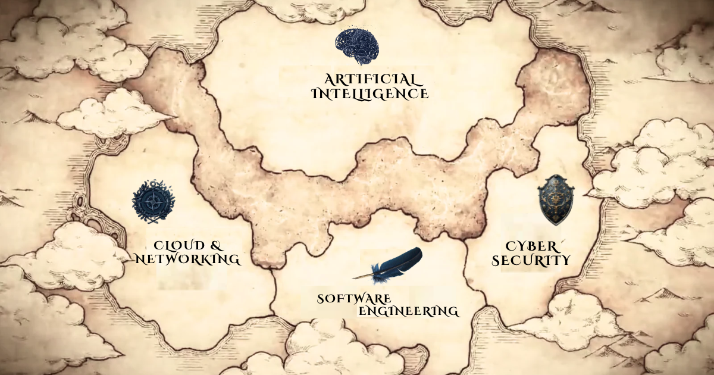

<!-- ===================================================== -->
<!--              THE CURIOSITY ARCHIVE                    -->
<!-- ===================================================== -->

  

  

<h1 align="center">The Curiosity Archive</h1>

  <em>A field journal of discoveries, experiments, and engineering.</em>

  <strong>VOL. I · 2026</strong>
   
  WHERE CURIOSITY BECOMES CREATION

  

<!-- ===================================================== -->
<!--                 I. THE KEEPER                          -->
<!-- ===================================================== -->

<h2> I. The Keeper of the Archive</h2>

  Greetings, fellow explorer.

I'm **Niama ES-Selymy**, an Intelligent Systems Engineering student exploring the intersection of Artificial Intelligence, cybersecurity, and intelligent systems.

Currently pursuing my Master's degree in **Intelligent Systems Engineering**, specializing in **Cloud, Networks & Security** at the Faculty of Sciences Ain Chock (FSAC), Université Hassan II, Casablanca.

My curiosity lies in understanding how intelligent systems work, how they can be secured, and how technology can solve problems beyond the screen.

I enjoy moving between experimentation and engineering: building AI-powered applications, exploring network security, developing connected systems, and turning ideas into functional solutions.

> *Every system has something to teach. Every experiment leaves a trace.*

**Current coordinates:** Casablanca, Morocco  
**Field of study:** Intelligent Systems Engineering  
**Primary interests:** AI · Cybersecurity · Cloud & Networking

  

<!-- ===================================================== -->
<!--                 II. DISCOVERY MAP                      -->
<!-- ===================================================== -->

<h2>II. The Discovery Map</h2>

  

Four territories currently occupy my map:

| Territory | Areas of exploration |
|:---|:---|
| **01 · Artificial Intelligence** | Machine Learning, LLMs, RAG, AI Agents, intelligent applications |
| **02 · Cybersecurity** | AI Security, Prompt Injection, Threat Detection, Zero Trust |
| **03 · Cloud & Networking** | Linux, Network Security, Distributed Systems, Docker, Micro-segmentation |
| **04 · Software Engineering** | Backend Development, Full-Stack Applications, REST APIs, System Design |

These territories often overlap. That's where some of my favourite engineering challenges begin.

  

<!-- ===================================================== -->
<!--                 III. SPECIMEN COLLECTION                -->
<!-- ===================================================== -->

<h2>III. The Specimen Collection</h2>

  <em>A collection of systems designed, experiments conducted, and problems explored.</em>

### SPECIMEN 001 · FarmShield

  

**Classification:** IoT · AI · Smart Agriculture  
**Status:** Group project · Team of 3  
**Repository:** Private

An intelligent farm-security platform designed to protect storage facilities, irrigation infrastructure, and farm perimeters against theft, water diversion, and intrusion.

FarmShield combines real-time sensor monitoring, remote mobile control, and local autonomous protection that continues working offline.

Its detection architecture includes:
- A three-model AI cascade for human/animal classification, dangerous-animal detection, and facial recognition.
- Isolation Forest for detecting suspicious insider activity and potential theft.
- Automatic responses through siren and irrigation-valve control.
- Mobile push notifications for security events, with a target response time under 5 seconds.

**Instruments:**  
`ESP32` `MQTT` `Node.js` `PostgreSQL` `React Native` `Flask` `TensorFlow Lite` `Isolation Forest`

---

### SPECIMEN 002 · TACTIX // BLACKBOX

**Classification:** Game AI · Algorithms · Data Structures  
**Status:** Academic project · Team of 3  
**Repository:** [TACTIX-blackbox](https://github.com/noura1se/TACTIX-blackbox)

A strategic game engine inspired by Tic-Tac-Toe, extended to 3×3, 4×4, and 5×5 boards.

Built around game-tree exploration, the engine uses Minimax enhanced with Alpha-Beta pruning, transposition tables, and heuristic evaluation to make strategic decisions.

**Notable mechanisms:**
- Minimax with Alpha-Beta pruning.
- Transposition tables and memoization.
- Sliding-window heuristic evaluation.
- Exploit Scan for threat and fork detection.
- Stack-based Undo mechanism (LIFO).
- Analytical dashboard for monitoring AI and player performance.

**Instruments:**  
`Python` `Flask` `REST API` `SQLite` `Tailwind CSS`

---

### SPECIMEN 003 · Coravita Clinic

**Classification:** Artificial Intelligence · Retrieval-Augmented Generation  
**Status:** Academic project · Team of 3

A private, locally hosted RAG assistant designed for clinic staff to retrieve information from patient records and internal policies.

The system processes documents using Docling, stores vector representations in Qdrant, and uses LLaMA 3.2 through Ollama to generate context-aware responses.

Its local-first architecture keeps sensitive clinic information within the clinic's environment rather than relying on external AI services.

**Instruments:**  
`Python` `Ollama` `LLaMA 3.2` `Qdrant` `Docling` `Streamlit`

---

### SPECIMEN 004 · Document Analysis Platform

**Classification:** Intelligent Document Processing · LLMs · Distributed Systems  
**Status:** Academic final-year project · Team of 3

An intelligent platform for analysing administrative documents such as transcripts, certificates, and formal requests.

Documents are indexed in Elasticsearch, then evaluated against configurable business rules. An LLM processes the relevant content and generates structured results, while Kafka supports asynchronous job processing.

**Instruments:**  
`Spring Boot` `Python` `PostgreSQL` `Elasticsearch` `Kafka` `MongoDB` `Docker` `Hugging Face`

---

### ADDITIONAL COLLECTIONS

**Lumenia Academy**  
A web-based learning platform.

[Explore repository →](https://github.com/Niama-ES/LumeniaAcademy)

**Pointage Virtuel**  
A virtual employee attendance management platform developed during my software engineering internship.

[Explore repository →](https://github.com/Niama-ES/PointageVirtuel)

  

<!-- ===================================================== -->
<!--                 IV. INSTRUMENT CABINET                  -->
<!-- ===================================================== -->

<h2>IV. The Instrument Cabinet</h2>

  Tools, languages, and technologies collected through coursework, projects, and experimentation.

### Programming Languages

`Python` `Java` `JavaScript` `TypeScript` `C` `C++` `PHP` `HTML5` `CSS3`

### Artificial Intelligence & Data

`Machine Learning` `LLMs` `RAG` `Prompt Injection Defense` `Hugging Face` `Ollama` `OpenCV` `Elasticsearch` `Apache Kafka`

### Backend & Frameworks

`Node.js` `Express.js` `Spring Boot` `Flask` `REST APIs` `JWT` `RBAC`

### Frontend & Mobile

`React.js` `React Native` `Angular` `Tailwind CSS` `Expo`

### Databases & Storage

`PostgreSQL` `MySQL` `SQLite` `Oracle SQL` `PL/SQL` `MongoDB` `Supabase` `Qdrant`

### IoT & Networking

`ESP32` `Arduino` `MQTT` `MQTT over TLS` `Sensor Integration` `Cisco Networking Fundamentals`

### Infrastructure & Tools

`Docker` `Linux` `Ubuntu` `Git` `GitHub` `Postman` `Google Colab` `Vim` `UML`

  

<!-- ===================================================== -->
<!--                 V. METAMORPHOSIS                        -->
<!-- ===================================================== -->

<h2>V. The Metamorphosis</h2>

  <em>The archive is never complete. There is always another question to investigate.</em>

### Current Expeditions

**EXPEDITION 001 · AI Agent Hijacking Defense**

ACTIVE RESEARCH · GROUP PROJECT OF 3

Developing a security layer between AI agents and the content they read or interact with, including emails, documents, web pages, and connected tools.

The objective is to inspect content before an agent acts on it, detecting and blocking hidden malicious instructions such as prompt injection attacks (OWASP LLM01) to prevent unintended actions and confidential-data leakage.

`Python` `Machine Learning` `LLM Agents`

---

**EXPEDITION 002 · Adaptive Zero Trust**

ACTIVE RESEARCH · MASTER'S PROJECT

Exploring lateral-movement detection and dynamic isolation in a multi-zone container network.

The architecture uses eBPF programs to monitor connections and enforce network policies through dynamically updated eBPF maps. An agent graph collects, correlates, classifies, decides, and verifies security events.

A dedicated "devil's advocate" node challenges isolation decisions to reduce false positives caused by legitimate activity such as backups, monitoring, and deployments.

`eBPF` `Docker` `Agent Graphs` `Micro-segmentation` `Zero Trust`

### Current Learning Notes

- AI Agent Security and Prompt Injection Defense.
- eBPF and Linux Network Monitoring.
- Container Security and Zero Trust Architecture.
- Cloud Infrastructure and Networking.
- Ethical Hacking and Security Fundamentals.

  

<!-- ===================================================== -->
<!--                 VI. FIELD RECORDS                       -->
<!-- ===================================================== -->

<h2>VI. Field Records & Certifications</h2>

A few milestones collected along the way:

- **Core Principles of Large Language Models** — April 2026.
- **Rapid Application Development with LLMs** — NVIDIA Deep Learning Institute, 2026.
- **Introduction to Agentic AI** — IEEE Student Branch FSAC, March 2026.
- **Introduction to Cybersecurity** — Cisco, 2026.

Additional exploration: Ethical Hacking — Cisco (in progress).

### Scientific Societies & Collaborations

**IEEE Student Branch UH2**  
Vice-President · Communication & Media  
March 2026 – Present

Contributing to communication strategy, media activities, event coordination, and the visibility of the student branch.

**AIESEC Morocco · Casablanca**  
Former Middle Manager Marketing & ICX Member  
February 2025 – February 2026

Contributed to digital communication, content creation, and international volunteer coordination.

**Eurafric Maroc**  
Software Engineering Intern  
December 2024 – February 2025

Designed and developed a virtual employee attendance platform, including REST API endpoints and technical documentation.

  

<!-- ===================================================== -->
<!--                 VII. CORRESPONDENCE                     -->
<!-- ===================================================== -->

<h2>VII. Correspondence</h2>

  <em>Every discovery begins with a question. Every collaboration with a conversation.</em>

  
  
  

  

  <strong>END OF CURRENT VOLUME</strong>
   
  <em>The archive is never truly complete.</em>
   
  CURIOUS BY NATURE · ENGINEERING BY DESIGN

